# VIC Recruitment

The tooling behind the 2026 recruitment of the **Vision & Innovation Club (VIC)**, a student club at the École
Nationale Polytechnique (ENP) in Algiers. Each season ENP students apply to join the club and are interviewed by
its members. This repository is what the club's recruitment team uses to run that process: it routes every candidate
to a pair of interviewers, keeps track of where each candidate stands, raises alerts when something is late or
wrong, and gives the team one dashboard over all of it.

It is an internal tool. Candidates never see it; they apply through the public landing page in
[vic-enp](https://github.com/puIad/vic-enp).

<p align="center">
  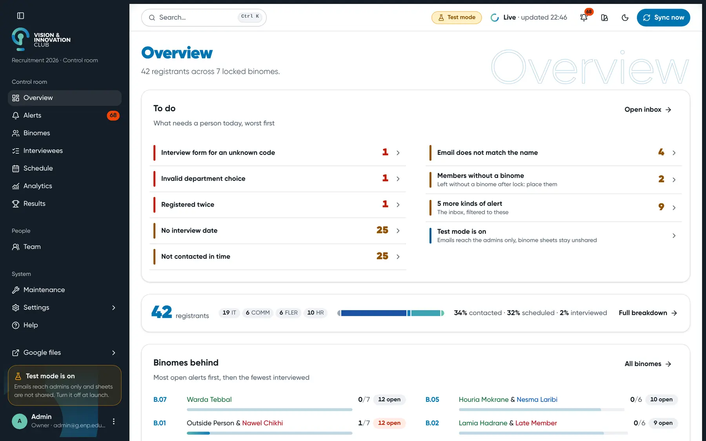
</p>

<p align="center">
  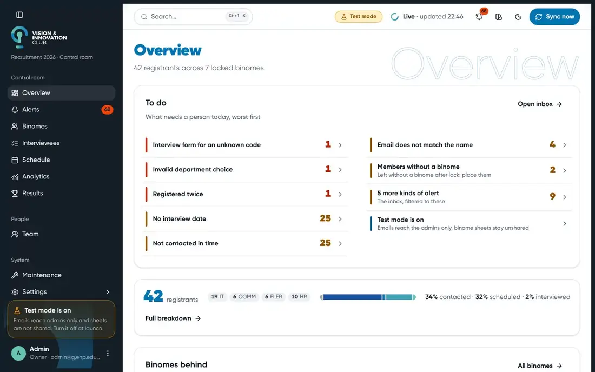
</p>

<sub>Every screen on this page runs on the local mock (`npm run mock -- --results` in `frontend/`): the people, codes and numbers are made up.</sub>

## How it works

A Google Sheet (the **Master**) is the database, an Apps Script bound to it does the work, and a web dashboard on
Vercel calls that script on behalf of whoever is signed in, so Google Drive sharing decides who can do what.

<p align="center">
  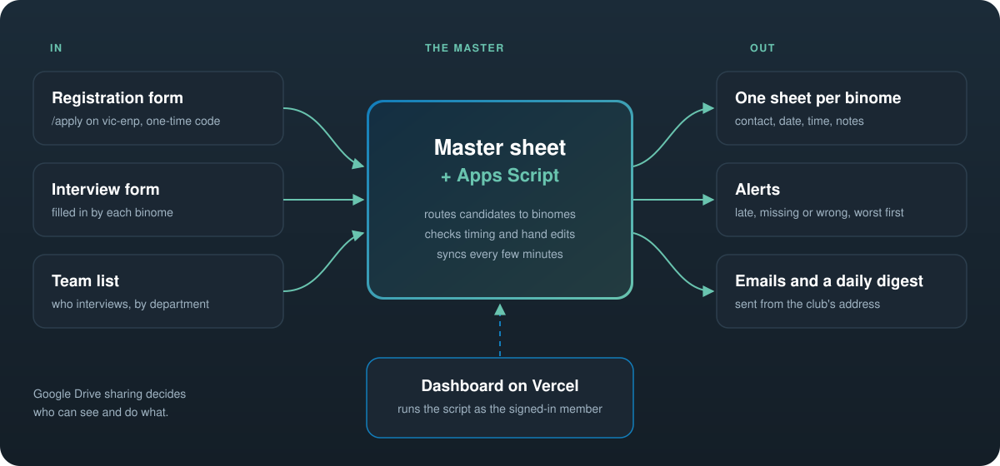
</p>

- **Binomes.** The interviewers work in pairs called binomes: one member of the HR team plus one member of another
  department, drawn at random. Each binome gets its own Google Sheet with its candidates in it.
- **Routing.** Each new registrant gets a code and is placed with a binome, by department.
- **Timing alerts.** The script checks that every candidate is contacted, scheduled and interviewed within the
  club's time limits, and flags the ones that are not.
- **Integrity checks.** A hand edit to the Master is detected, so it can be applied, reverted or accepted before it
  silently breaks sharing or history.
- **Screening and changes after lock.** The team can hold or decline low-effort applications, replace or swap a
  binome member, add a temporary cover, or move a candidate to another binome, each with a preview first.

## A look around

| | |
|---|---|
| 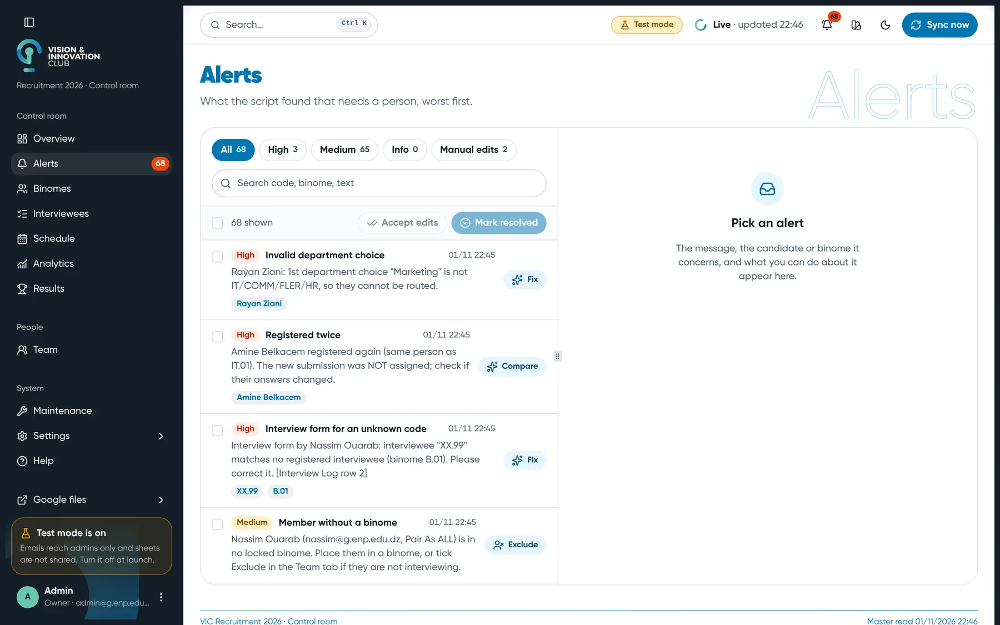 | 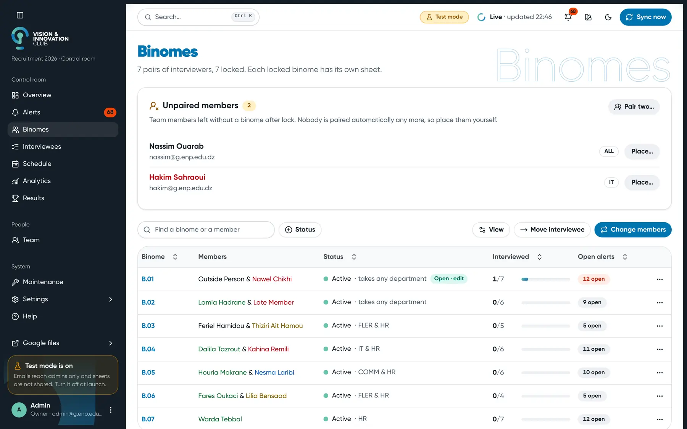 |
| **Alerts.** What the script found that needs a person, worst first, many with a quick fix beside them. | **Binomes.** Every pair of interviewers, how far they are and what's open, with changes previewed before they apply. |
| 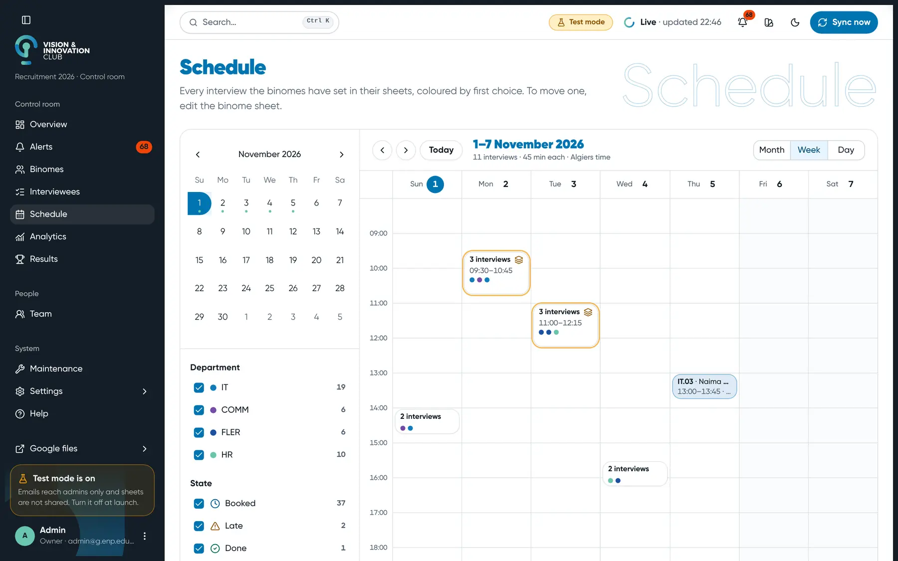 | 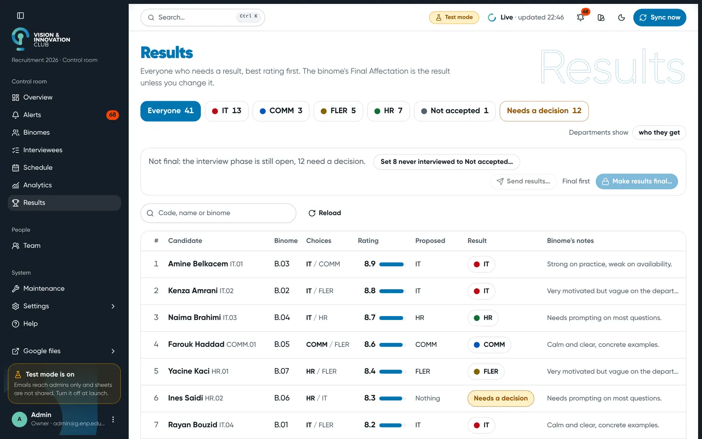 |
| **Schedule.** Every interview the binomes set in their sheets, by week, coloured by first choice. | **Results.** Everyone who needs a result, best rating first, with the binome's proposal and notes. |
| 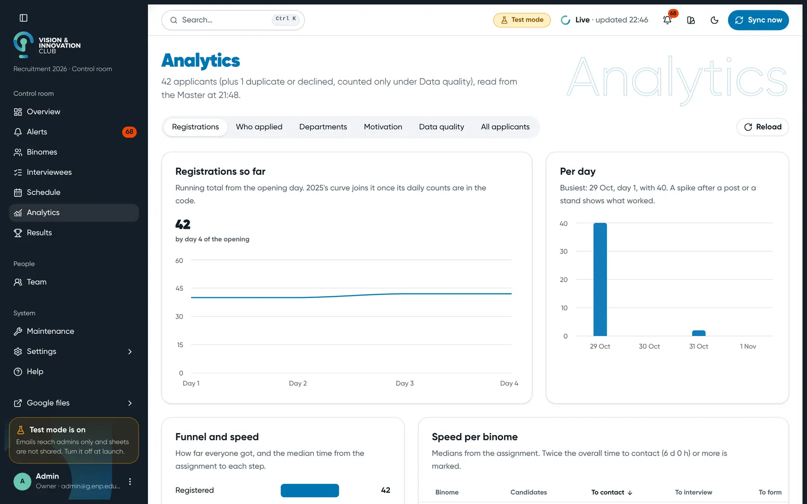 | 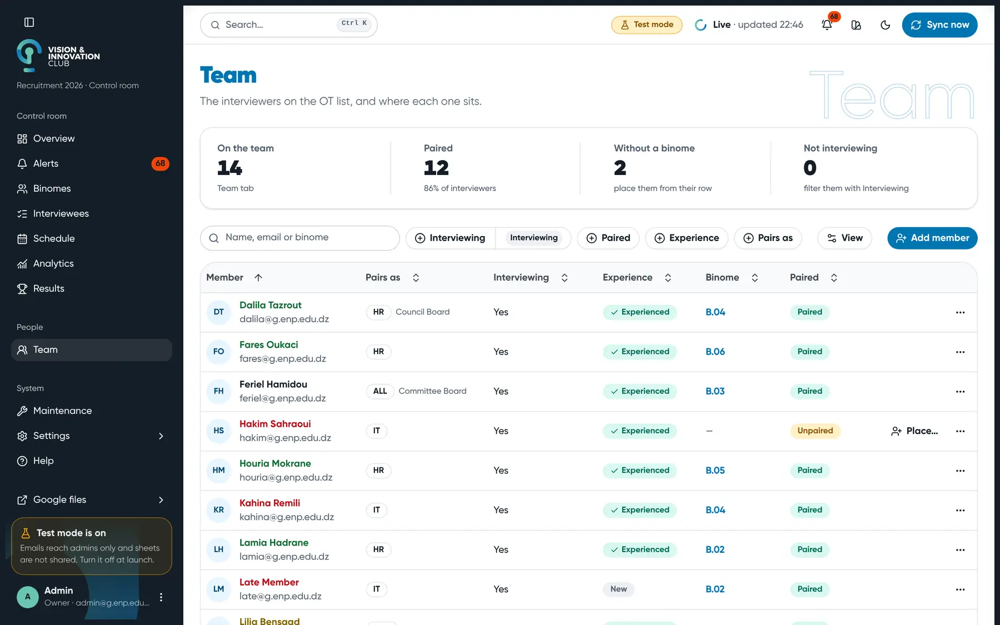 |
| **Analytics.** Registrations over time, who applied, and how fast each binome moves. | **Team.** The interviewers, who is paired, who is experienced, and who isn't interviewing. |

### Light and dark

| | |
|---|---|
|  | 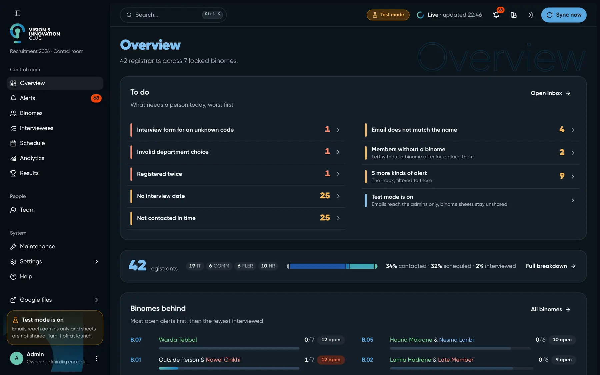 |
|  | 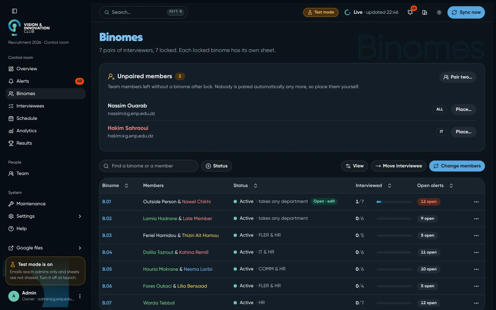 |

### What a member sees

An interviewer who isn't an admin gets **My binome**: their own candidates and open alerts, nothing else. With edit
access they fill in their columns from here, and it writes straight into their binome sheet.

<p align="center">
  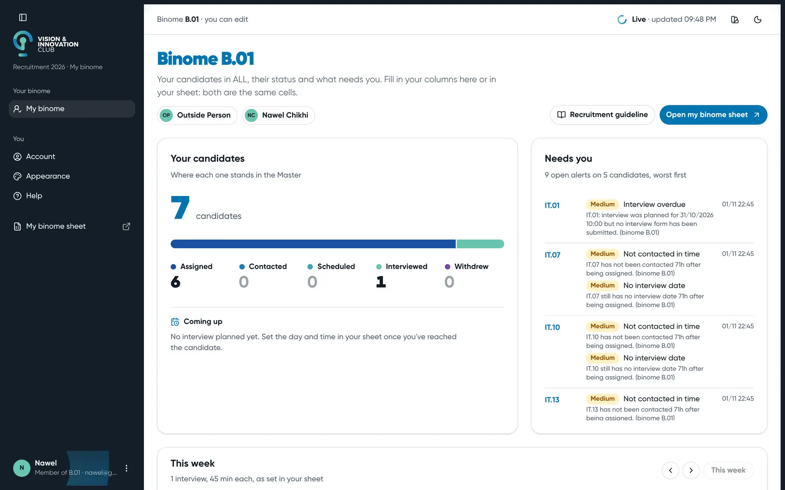
  &nbsp;
  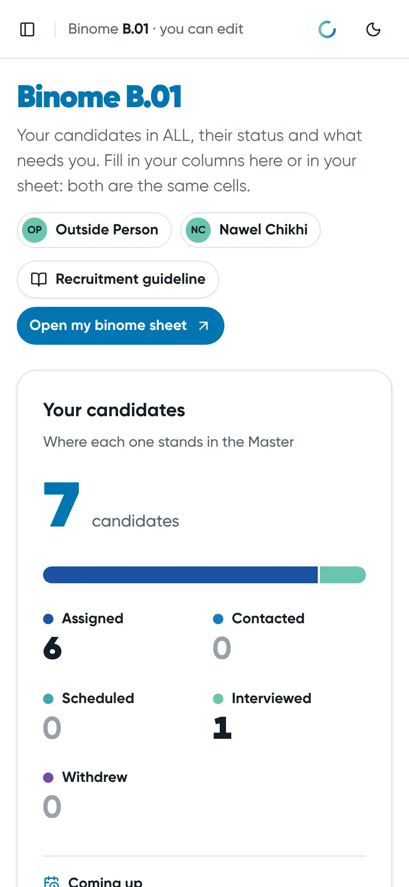
</p>

<p align="center">
  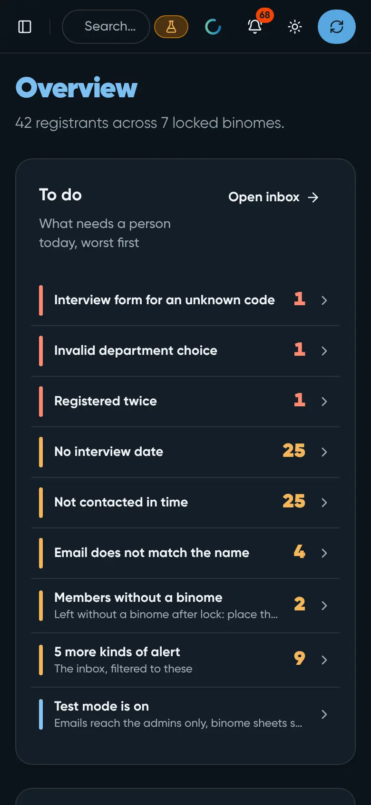
  <br><sub>The admin Overview on a phone</sub>
</p>

## What's in the repo

| Path | What |
|---|---|
| `*.gs`, `appsscript.json` | the Apps Script bound to the Master: config, pairing and routing rules, sync, alerts, mail, the API the dashboard calls |
| `frontend/` | the dashboard: Vite, React 19, TypeScript, Tailwind CSS v4, shadcn/ui |
| `web/` | the Vercel project: Google sign-in, sessions, and the `/api/run` proxy to the Apps Script |
| `mailer/` | a small standalone Apps Script that sends the registration form's one-time codes |
| `test/` | in-memory mocks of Apps Script and Google, the test suites, and a local mock backend |
| `docs/` | architecture, decisions, testing, and the specs of each feature |
| `PRODUCT.md`, `DESIGN.md` | who the dashboard is for, and its visual system based on the VIC charter |

## Run it locally

You need Node.js 24. Nothing below needs a Google account: the tests and the local dashboard run against mocks.

```bash
npm install
npm test                 # every suite, on an in-memory mock of Apps Script and Google
```

To open the dashboard on mock data (40 seeded registrations, a couple of hand edits to resolve):

```bash
cd frontend
npm install
npm run mock             # terminal 1: mock Google plus the real web/api functions on :3000
npm run dev              # terminal 2: then open the link below
```

Then open `http://localhost:5173/dev-login?as=admin@g.enp.edu.dz`. Use `?as=stranger@g.enp.edu.dz` to see the
no-access screen, or `?as=` to see the signed-out screen. `npm run build` in `frontend/` type-checks and builds
into `web/dist/`.

`npm run test:ui` opens every dashboard page in a headless browser and fails on any console error; it needs
`npx playwright-core install chromium-headless-shell` once.

Deploying the Apps Script (`npm run deploy`, through `clasp`) and the Vercel project needs the club's own Google
and Vercel accounts, so it only works for the team running the recruitment. More in
[`docs/testing.md`](docs/testing.md) and [`docs/vercel.md`](docs/vercel.md).

## Privacy

The repository holds code and made-up test data only. No real candidate or member data is committed: the
test suites seed fictional people, and the replay of past data reads from a git-ignored folder. On the live
system, tokens never reach the browser, and logs record who ran which action and how long it took, never
candidate data.

## Fonts and brand assets

- **Gilroy**, the club's typeface, is a commercial font. The files in `assets/Gilroy/` and
  `frontend/src/assets/fonts/` are the club's own copies and are not licensed for reuse or redistribution. If you fork this
  project, swap in a font you have the rights to.
- The VIC name and logo belong to the Vision & Innovation Club and are not open for reuse.
- The dashboard started from the ShadcnStore dashboard template, MIT licensed
  ([`frontend/LICENSE-template.md`](frontend/LICENSE-template.md)).

## Contributing

This is built and maintained by VIC's IT department for the club's own recruitment, so it is shaped around VIC's
rules and isn't meant to be dropped into another club unchanged. Issues are welcome; you can also reach the club at
vic@g.enp.edu.dz or on Instagram at [@vic.enp](https://www.instagram.com/vic.enp/).

No open-source licence has been chosen for this repository's own code, so it is all rights reserved unless a
licence file is added later.
